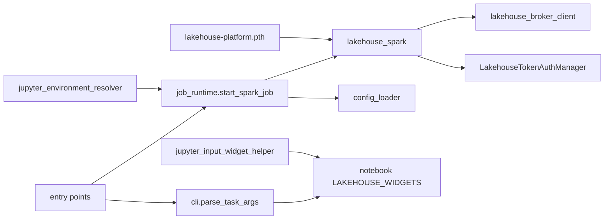

# Component Dependencies — Platform Spark Session Helper

| From | Depends on | How |
|---|---|---|
| C5 images | C1, C2, C3 | `COPY infra/workload-python/python/ /opt/lakehouse/python/` and the `.pth` into the venv |
| C1 | C2 (Jupyter only), the Java token provider | import; the `LAKEHOUSE_*` environment contract |
| C6 | C1, `config_loader`, C7 | import `lakehouse_spark` lazily (pyspark only when starting) |
| C8 | C6 | `start_spark_job` |
| C7 `parse_task_args` | C9's `LAKEHOUSE_WIDGETS` (Jupyter) | the notebook's namespace through `IPython.get_ipython().user_ns` |
| Smoke bootstrap | none of the above | its own complete catalog settings |

Text alternative: the `.pth` file makes `lakehouse_spark` importable; it uses the broker client in Jupyter and the Java token provider. The repository's `start_spark_job` uses `lakehouse_spark` and `config_loader`; the environment resolver calls `start_spark_job`. The widget helper stores widgets in the notebook namespace, where `parse_task_args` reads them. Entry points use `start_spark_job` and `parse_task_args`.
