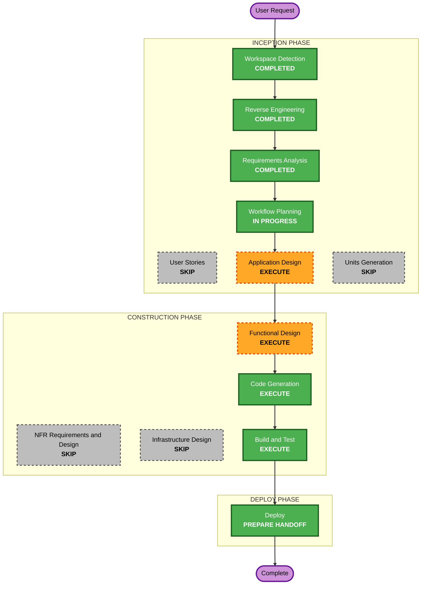

# Execution Plan — Platform Spark Session Helper

## Detailed Analysis Summary
- **Transformation type**: a relocation of Spark session setup from product repositories into the platform's workload environment, plus a workload-repository refactoring. No new service.
- **Change impact**:
  - **User-facing**: data engineers call `start_spark_job` as before; in Jupyter they can choose the environment with `%env LAKEHOUSE_ENVIRONMENT=...`, pass `TASK_ARGS`, and run `%run ../common/jupyter_environment_resolver.py` instead of `%run ./jupyter_helper.py`.
  - **Structural**: a platform module, `lakehouse_spark`, in both images and importable in Airflow run containers; the repository's `job_runtime.py` shrinks to config loading plus one call.
  - **Contracts**: unchanged DAG and task IDs, workflow JSON, config format, Java token contract.
- **Risk**: medium.
  - **Not yet proven** (Application Design probes):
    - making `/opt/lakehouse` modules importable in Airflow run containers although the factory sets `PYTHONPATH=/opt/lakehouse-bundle` (for example a `.pth` in the venv), without breaking the venv-equals-lock check;
    - one source for catalog settings across `spark-defaults.conf` and the module, and the effect on `infra/spark-bootstrap/create_smoke_tables.py`;
    - reading the notebook's `TASK_ARGS` and notebook name (`JPY_SESSION_NAME`) from library code in a kernel;
    - `%run ../common/...` with the kernel's working directory;
    - returning an existing session only for the same default catalog;
    - `ipywidgets` in the workload lock (versions compatible with ipykernel 6.29.5 and JupyterLab 4.3.5) and widgets rendering in JupyterLab; reading `WIDGET_LIST` and the widgets from the notebook's namespace during `%run` (CR-3).
  - **Ordering**: the new images must keep the current repository code (its own session setup) working, so the repository change can follow.
- **Rollback**: platform side: rebuild the images from the previous files; workload repository: revert its commit on `main` and `uat`.
- **Testing**: offline example and Hypothesis tests on both sides; live: both images, a UAT run before and after the repository push, a Jupyter session by the user, Jenkins CI.

## Workflow Visualization

Text alternative: Workspace Detection, Reverse Engineering and Requirements Analysis are completed. Workflow Planning leads to Application Design, Functional Design, Code Generation, Build and Test, and the Deploy handoff. User Stories, Units Generation, NFR and Infrastructure Design are skipped.

## Phases
- [x] Workspace Detection, focused Reverse Engineering, Requirements Analysis (with CR-1): COMPLETED.
- [ ] User Stories: SKIP. Data engineers are the existing persona; the requirements state the contract.
- [ ] Application Design: **EXECUTE**. Module location and delivery into both images and Airflow run containers; the single source of catalog settings; the module's API; the resolver's run-versus-import behavior. Probes first, in throwaway containers.
- [ ] Units Generation: SKIP. One unit, `spark-session`, delivered in two repositories.
- [ ] Functional Design: **EXECUTE**. Token-source selection and errors, catalog settings, the existing-session rule, environment resolution, the application name, `TASK_ARGS`, the declarative task-argument format and its structural errors, with no value validation (CR-2), and the input widgets and their precedence over `TASK_ARGS` (CR-3), property identification.
- [ ] NFR Requirements, NFR Design, Infrastructure Design: SKIP. Security and Resiliency are off; no new service.
- [ ] Code Generation: **EXECUTE**. Platform side first, then the workload change in the scratchpad clone, pushed only on approval.
- [ ] Build and Test: **EXECUTE**, live, in the order of FR-7.
- [ ] Deploy: **EXECUTE**, as a handoff.

## Canonical Knowledge Impact Inventory
| Canonical path | Action | Requirement and component | Reason |
|---|---|---|---|
| `aidlc-docs/knowledge/opensource-lakehouse-infra-v2/application-design.md` | UPDATE | FR-1, FR-2 ("Airflow and shared Spark runtime", JupyterHub, known limits) | Session setup becomes platform-owned in both contexts; the limit "workload repositories still configure Spark sessions themselves" is retired |
| `aidlc-docs/knowledge/opensource-lakehouse-infra-v2/functional-design/workload-python-environment.md` | UPDATE | FR-1, CR-3 (workload Python environment) | The session module is part of what the platform puts into both images for workload code, delivered with the venv; same component boundary, so no new document. The base set gains `ipywidgets`, JupyterLab `jupyterlab_widgets` |
| `aidlc-docs/knowledge/opensource-lakehouse-infra-v2/functional-design/airflow-workflows.md` | UPDATE | FR-2, FR-4 (repository-side contract) | `start_spark_job` on the platform module; `task_args()` and `TASK_ARGS` in Jupyter; declared task arguments (CR-2); the resolver's path |
| `aidlc-docs/knowledge/opensource-lakehouse-infra-v2/functional-design/lakehouse-product-access.md` | RETAIN | none | Identities, the Spark journey and the token contract are unchanged |
| `aidlc-docs/knowledge/opensource-lakehouse-infra-v2/functional-design/jenkins-ci-access.md` | RETAIN | none | CI is unchanged |
| `aidlc-docs/knowledge/opensource-lakehouse-infra-v2/functional-design/starrocks-sql-access.md` | RETAIN | none | Unaffected |

## Package Change Sequence
1. **Probes** (Application Design).
2. **Platform module** in both images, with tests (FR-1); `ipywidgets` added to the workload lock and `jupyterlab_widgets` to JupyterLab (CR-3).
3. **README** (FR-6, platform part).
4. **Live, platform side**: rebuild both images; the current workload code still runs (a UAT run) and Jupyter still works.
5. **Workload repository change** in the scratchpad clone: `job_runtime.py`, `jupyter_environment_resolver.py` (CR-1), `cli.py`, entry points, docs, tests (FR-2 to FR-6); pushed after approval.
6. **Live, after the push**: UAT runs, Jenkins CI, and a Jupyter session checked by the user.

## Success Criteria
- Catalog, token and redaction settings exist only in the platform; the workload repository no longer contains them.
- Airflow UAT runs (`test_environment`, `generate_tpch`) pass before and after the repository push.
- In Jupyter: `dev` by default, `%env LAKEHOUSE_ENVIRONMENT=uat` selects UAT, `TASK_ARGS` reaches `task_args()`, the resolver runs from `notebooks/common`.
- `generate_tpch.py` declares its arguments with the common parser and gets the same values from the workflow in Airflow and from widgets (or `TASK_ARGS`) in Jupyter (CR-2, CR-3).
- The infrastructure and workload suites pass, including the new Hypothesis properties.
