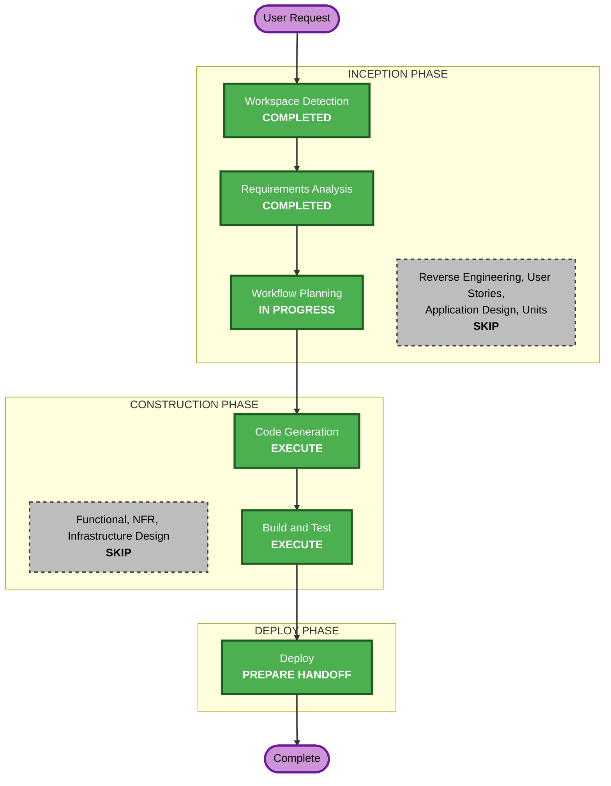

# Execution Plan — Repository Rename

## Detailed Analysis Summary
- **Transformation type**: configuration, documentation and an operational recreation; no code or behavior change.
- **Change impact**: the product file's repository URL (Airflow bundles and Jenkins jobs keep their names); container mounts move to the new folder; the notebooks' Initialization path.
- **Risk**: low to medium. The recreation interrupts open notebook servers; Airflow is recreated (bundles change). Rollback: the old URL still redirects; the stack can be recreated again.

## Workflow Visualization

Text alternative: Workspace Detection and Requirements Analysis are completed; Workflow Planning leads to Code Generation, Build and Test, and the Deploy handoff. Reverse Engineering, User Stories, Application Design, Units Generation, and the Functional, NFR and Infrastructure Design stages are skipped.

## Phases
- [ ] Reverse Engineering, User Stories, Application Design, Units Generation: SKIP. No new component, method or interface; the references were inventoried directly.
- [ ] Functional, NFR, Infrastructure Design: SKIP. No business logic; no new infrastructure.
- [ ] Code Generation: **EXECUTE** (one unit, `rename`): platform file, README and test; workload notebooks, README, AGENTS.md and test in the scratchpad clone (pushed on approval); the scratchpad remote.
- [ ] Build and Test: **EXECUTE**: host and workload suites; the stack recreated from the new folder (`start`, `start-airflow`) with no active run; the checks of requirements.md.
- [ ] Deploy: **EXECUTE**, as a handoff.

## Canonical Knowledge Impact Inventory
| Canonical path | Action | Requirement | Reason |
|---|---|---|---|
| `aidlc-docs/knowledge/opensource-lakehouse-infra-v2/application-design.md` | UPDATE | FR-2, FR-6 | Five mentions of the workload repository's name |
| `aidlc-docs/knowledge/opensource-lakehouse-infra-v2/functional-design/airflow-workflows.md` | UPDATE | FR-4, FR-6 | The repository name and the Initialization path |
| `aidlc-docs/knowledge/opensource-lakehouse-infra-v2/functional-design/workload-python-environment.md` | UPDATE | FR-6 | One mention of the repository name |
| `aidlc-docs/knowledge/opensource-lakehouse-infra-v2/functional-design/jenkins-ci-access.md` | RETAIN | none | No old name |
| `aidlc-docs/knowledge/opensource-lakehouse-infra-v2/functional-design/lakehouse-product-access.md` | RETAIN | none | No old name |
| `aidlc-docs/knowledge/opensource-lakehouse-infra-v2/functional-design/starrocks-sql-access.md` | RETAIN | none | No old name |

The knowledge folder name (`opensource-lakehouse-infra-v2`) and the archives are retained unchanged.

## Success Criteria
- No container refers to the old folder; `default-main`/`default-uat` track `opensource-lakehouse-sample-dp`; UAT runs and Jenkins pass; JupyterHub works; the suites pass.
