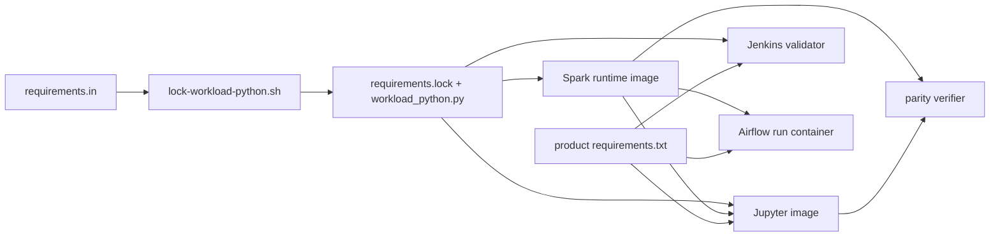

# Component Dependencies — Shared Workload Requirements

| From | Depends on | How |
|---|---|---|
| C3 Spark runtime image | C1 lock and module | `COPY infra/workload-python/...` (build context is the workspace root) |
| C4 Jupyter image | C1; C3 | `COPY` of C1; `/opt/spark` and the JVM from C3 as today |
| C5 DAG factory | C3 at run time | calls `/opt/lakehouse/venv/bin/python` and `/opt/lakehouse/workload_python.py` inside the run container |
| C6 CI validator | C1 | read-only mount `./infra/workload-python:/opt/lakehouse/workload-python:ro` |
| C7 parity verifier | C3, C4 | `docker run` of both images: `check-venv` and `pip freeze` |
| C2 lock generator | the runtime's base image digest | the same digest as `infra/spark-runtime/Dockerfile` |
| C8 workload repository | C5, C6 (contract); C3, C4 (packages) | `requirements.txt` at the root; `generate_tpch.py` imports `duckdb` |

Text alternative: `requirements.in` is turned into the lock by the generator. The lock and module go into both images and the Jenkins validator. The Jupyter image also copies Spark from the runtime image. A product's `requirements.txt` is checked in CI, installed in each Airflow run container, and installed on demand in Jupyter. The parity verifier reads both images.
