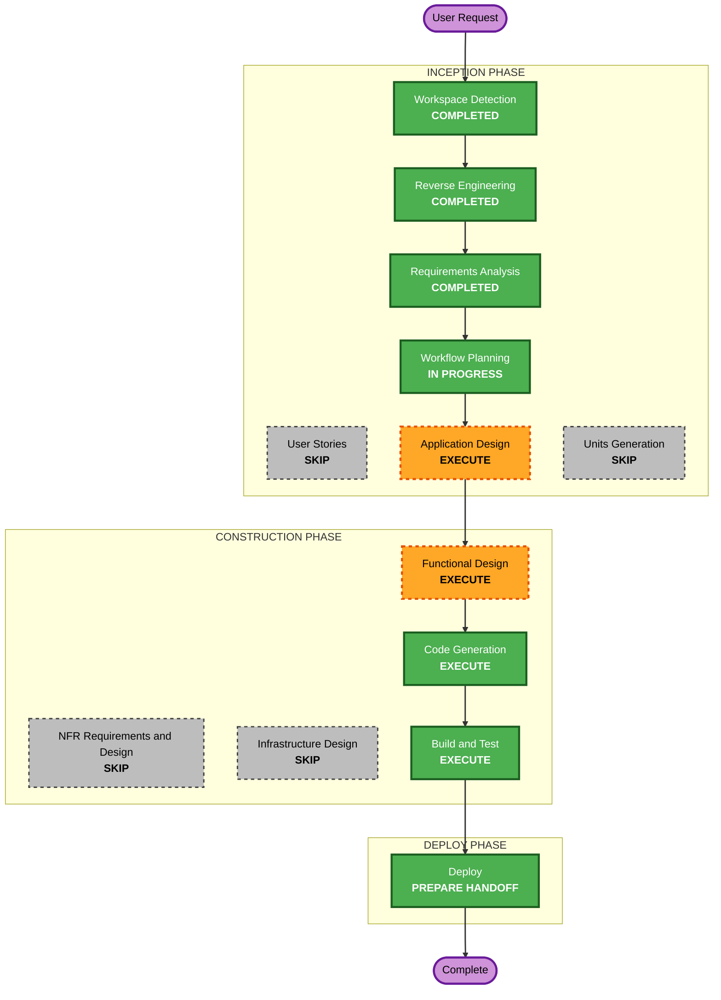

# Execution Plan — Shared Workload Requirements

## Detailed Analysis Summary
- **Transformation type**: an infrastructure and platform change across both workload images, the DAG factory, the CI validator and Jupyter, plus a docs-and-example change in the workload repository. No new service.
- **Change impact**:
  - **User-facing**: yes, for data engineers.
    - Notebooks and Airflow runs see the same Python 3.10 and the same packages.
    - Products can declare extras in `requirements.txt`.
    - Jupyter offers one kernel, "Lakehouse (Python 3.10)". Code that relied on scipy, matplotlib or pyiceberg from the runtime base image loses them unless they're added.
  - **Structural**: a new platform-owned artifact, the workload Python lock, consumed by two images, the factory and the validator. A new DAG task, `install_requirements`.
  - **API and contract**: the product repository contract gains an optional root `requirements.txt`, and `sparse_dirs` gains that file.
  - **NFR**: determinism and isolation improve. Runs with extras need PyPI and take longer.
- **Risk**: medium.
  - **Not yet proven** (Application Design probes):
    - a Python 3.10 interpreter in the Ubuntu 26.04 Jupyter image (glibc 2.43), from conda or a standalone build, at 3.10.16;
    - the lock resolving identically for both builds: the same wheels on aarch64, for both glibc 2.31 and 2.43;
    - a per-user extras location that a venv without user site-packages still sees (for example a `.pth` file or `PYTHONPATH` entry pointing into the user's home);
    - the run container's user and write permissions for a run-local `pip install --target` on the venv's path;
    - `PYSPARK_PYTHON` taking effect for `spark-submit` in `local[*]` mode and for local Spark in the kernel;
    - the Jupyter Hub broker token provider and `/opt/lakehouse` modules still importing in the new kernel;
    - DuckDB's `tpch` extension download and cache in the run container's home, shared by the eight `generate_tpch` tasks (CR-2).
  - **Effect on runs**: both images are rebuilt; DAGs gain a task (new task IDs, existing ones unchanged); Airflow is recreated once for `sparse_dirs`.
- **Rollback**: rebuild the images from the previous Dockerfiles; revert the factory's `install_requirements` and `sparse_dirs`; the workload repository change is docs plus one optional file, reverted by a commit on `main` and `uat`.
- **Testing**:
  - **Offline**: lock parsing, the extras line rules, the image check logic, Dockerfile and Compose contracts, the factory's new task, Hypothesis properties.
  - **Live**: both image builds with their checks, the parity verifier, a UAT run without extras, a run with the `duckdb` extras, the CI check, and a Jupyter kernel on 3.10 with pandas and the extras command.

## Workflow Visualization

Text alternative: Workspace Detection, Reverse Engineering and Requirements Analysis are completed. Workflow Planning leads to Application Design, Functional Design, Code Generation, Build and Test, and the Deploy handoff. User Stories, Units Generation, NFR and Infrastructure Design are skipped.

## Phases
- [x] Workspace Detection, focused Reverse Engineering, Requirements Analysis: COMPLETED.
- [ ] User Stories: SKIP. Data engineers are the existing persona, and the requirements already state the contract.
- [ ] Application Design: **EXECUTE**.
  - **Decisions**:
    - where the lock and its tooling live (`infra/workload-python/`), and how both build contexts receive it (the Jupyter image already copies from the runtime image);
    - how Jupyter gets Python 3.10 (a conda environment versus a standalone CPython build);
    - the lock generator (resolve in the runtime image; `pip freeze` of a clean venv versus `pip install --dry-run --report`);
    - the run-local extras location and how the venv sees it;
    - the per-user Jupyter extras location;
    - the kernel spec, and removing the conda kernel;
    - the lock's delivery to Jenkins (read-only mount).
  - **Probes before code**: all items under "Not yet proven", in throwaway containers, without touching running services.
- [ ] Units Generation: SKIP. One unit, `workload-python`, delivered in two repositories.
- [ ] Functional Design: **EXECUTE**. The lock format and rules, the extras line rules (allowed and refused forms), the image check, the parity rules, the `install_requirements` task behavior (absent file, conflict, failure, redaction), the Jupyter command's behavior, and property identification.
- [ ] NFR Requirements, NFR Design, Infrastructure Design: SKIP. Security and Resiliency are off, Hypothesis is already selected, and there is no new service or network.
- [ ] Code Generation: **EXECUTE**. The platform side first, then the workload change in the scratchpad clone, which is pushed only on approval.
- [ ] Build and Test: **EXECUTE**, live.
- [ ] Deploy: **EXECUTE**, as a handoff.

## Canonical Knowledge Impact Inventory
| Canonical path | Action | Requirement and component | Reason |
|---|---|---|---|
| `aidlc-docs/knowledge/opensource-lakehouse-infra-v2/application-design.md` | UPDATE | FR-1 to FR-5 ("Airflow and shared Spark runtime", JupyterHub, startup and bootstrap) | Both images carry the shared venv; the Jupyter kernel changes; the image builds gain checks |
| `aidlc-docs/knowledge/opensource-lakehouse-infra-v2/functional-design/workload-python-environment.md` | CREATE | FR-1 to FR-6 (shared workload Python environment) | A new durable platform concern owned by neither Airflow nor Jupyter alone: the lock, its regeneration, the venv in both images, the extras rules in both runtimes, and the parity checks. No canonical document covers it |
| `aidlc-docs/knowledge/opensource-lakehouse-infra-v2/functional-design/airflow-workflows.md` | UPDATE | FR-4, FR-6 (platform DAG factory and validator) | The new `install_requirements` task, `sparse_dirs` gains `requirements.txt`, the validator's extras check, and the limit "only the Spark image's packages" is replaced |
| `aidlc-docs/knowledge/opensource-lakehouse-infra-v2/functional-design/jenkins-ci-access.md` | UPDATE | FR-6 | The lock mounted read-only for product CI jobs |
| `aidlc-docs/knowledge/opensource-lakehouse-infra-v2/functional-design/lakehouse-product-access.md` | RETAIN | none | Access, identities and Hub admission are unchanged |
| `aidlc-docs/knowledge/opensource-lakehouse-infra-v2/functional-design/starrocks-sql-access.md` | RETAIN | none | Unaffected |

## Package Change Sequence
1. **Probes** (Application Design).
2. **Lock and tooling**: `infra/workload-python/requirements.in`, the generator script, the generated `requirements.lock`, and the check script (FR-1, FR-6).
3. **Spark runtime image**: the venv, the lock, `PYSPARK_PYTHON`, the build check (FR-2, FR-6).
4. **Jupyter single-user image**: Python 3.10, the venv, the single kernel, `lakehouse-install-requirements`, the build check (FR-2, FR-3, FR-5, FR-6).
5. **DAG factory and validator**: `install_requirements`, `sparse_dirs`, the CI extras check, the lock mount in Jenkins (FR-4, FR-6).
6. **Parity verifier, tests, README** (FR-6, FR-8).
7. **Live, platform side**: rebuild both images, recreate Airflow and Jenkins, run the checks and a UAT run without extras.
8. **Workload repository change** in the scratchpad clone, tested; pushed after approval (FR-7, CR-1 and CR-2: docs, `requirements.txt`, `generate_tpch.py`, `workflows/generate_tpch.json`).
9. **Live, after the push**: a UAT run of `default-uat-generate_tpch` (extras installed, eight counts checked), CI, and the Jupyter command.

## Success Criteria
- Both images hold `/opt/lakehouse/venv` on Python 3.10 with exactly the lock, and the parity verifier passes.
- Airflow `spark-submit` and the Jupyter kernel both run on that venv; "Lakehouse (Python 3.10)" is the only kernel.
- A UAT run without extras passes with no network install; a run with `duckdb==1.5.6` installs it, imports it, and leaves locked versions unchanged.
- `default-uat-generate_tpch` succeeds: all eight `generate_<entity>` tasks report the expected TPC-H counts at scale 0.01 (CR-2).
- A conflicting or forbidden extras line fails CI and fails `install_requirements` before workload code runs.
- The infrastructure and workload suites pass, including the new Hypothesis properties.
