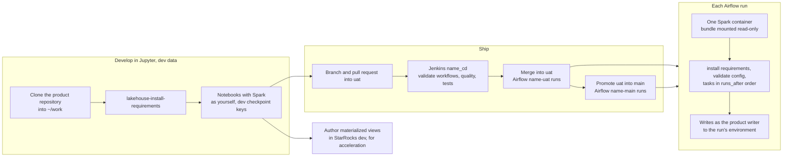

# Data product developer journey

For a product's developers (group `role-<product>-developer`, for example `joe-developer` in `role-default-developer`): building notebooks and workflows, running them in Jupyter and Airflow, and authoring materialized views. Back to the [README](../../README.md).

**The detailed repository structure lives in the sample data product repository**, [`opensource-lakehouse-sample-dp`](https://github.com/cdiogo1979/opensource-lakehouse-sample-dp): subprojects, medallion layers, the notebook standard, naming conventions, and the shared helpers. This page covers what the platform provides and expects.

Your default access: read prod and UAT, read and write dev, author materialized views in dev ([access levels](../reference/data-products.md#access-levels)).

## Journey at a glance



Text alternative: you develop in Jupyter on dev data: clone the product repository into `~/work`, install its extra packages, and run notebooks whose Spark session acts as you, with the dev checkpoint keys of your products. To ship, push a branch and open a pull request into `uat`; Jenkins `<product>_cd` validates the workflows and runs the quality checks and tests; after the merge, Airflow's `<product>-uat` bundle runs it, and after promotion from `uat` into `main`, `<product>-main`. Each Airflow run starts one Spark container with the bundle mounted read-only, installs the requirements, validates the config, runs your tasks in `runs_after` order, and writes as the product's writer. You also author materialized views in StarRocks dev to accelerate queries.

## 1. Work in Jupyter

1. Sign in at <http://jupyterhub.localhost:8000> and start your server (1 CPU, 2 GiB).
2. Clone your product repository into `~/work` with the Git sidebar or a terminal, for example `git clone https://github.com/cdiogo1979/opensource-lakehouse-sample-dp.git`.
3. Install the repository's extra packages: `lakehouse-install-requirements` in the repository (rerun after every server start), then restart the kernel.
4. Start Spark as yourself:

   ```python
   from lakehouse_spark import create_spark_session
   spark = create_spark_session()
   ```

   Product repositories wrap this in their own start-up (`start_spark_job`), which reads `configs/dev.yml`.

- The only kernel is **Lakehouse (Python 3.10)**, the same Python and packages as Airflow's Spark runs.
- **Memory**: each notebook with a Spark session holds 1 to 1.5 GiB until its kernel shuts down; shut down a notebook's kernel before starting another Spark notebook.
- More: [JupyterHub](../reference/jupyterhub.md).

## 2. The repository contract (platform side)

| A product repository holds | The platform does |
|---|---|
| `workflows/<project>/<name>.json` (or flat `workflows/<name>.json`), one DAG each | Builds `<bundle>-<name>` DAGs with the platform factory; validates the files in CI |
| `notebooks/workload/<project>/[<layer>/]<file>.py` (Jupytext entry points) | Runs each task with `spark-submit` in the run's Spark container |
| `configs/<env>.yml` (`storage_path`, `database_name`, `catalog_name`, optional `checkpoint_path`) and optional `configs/<product>/<env>.yml` | Passes `--environment` and `--config-dir`; the repository's loader reads them |
| `dags/lakehouse.py`, a fixed stub, and nothing else in `dags/` | Refuses anything else in CI |
| optional root `requirements.txt` (pinned extras) | Installs them per run and in Jupyter, constrained by the platform lock |

Workflow JSON, task fields, subprojects and layers: [Airflow — workflow files](../reference/airflow.md#workflow-files). Package rules: [Workload Python environment](../reference/workload-python.md#a-products-extra-packages).

## 3. Run in Airflow

1. Push to a branch and open a pull request into `uat`: Jenkins `<product>_cd` runs `lakehouse-validate-workflows`, code quality and tests.
2. After the merge, `<product>-uat-<name>` appears in Airflow within about five minutes; trigger it at <http://127.0.0.1:8085>.
3. Each run starts its own Spark container, installs the extras, validates the config, runs your tasks in `runs_after` order, and writes as the product's writer.

- **All tasks of a run share one Spark container**: tasks without `runs_after` start together; order them so only a few Spark jobs run at once.
- **Arguments**: `args` are passed after `--` to the entry point and are never templated. For one run, give a task extra or different arguments in the trigger form's `task_args`, for example `{"tpch_region_load": {"silver_lookback_days": "7"}}` ([how](../reference/airflow.md#workflow-files)).
- More: [Airflow](../reference/airflow.md).

## 4. Spark sessions

`lakehouse_spark.create_spark_session(app_name, catalog)` is the platform's only Spark session: the three Polaris catalogs, the token source (the run's broker or your Jupyter token, never a fallback), redaction, and checkpoint settings. Never configure catalogs, tokens or redaction in a repository. Details: [Workload Python environment — Spark sessions](../reference/workload-python.md#spark-sessions).

## 5. Streaming jobs

Set `checkpoint_path: s3ckpt://<bucket>/checkpoints` in `configs/<env>.yml` (your environment's own bucket) and give each stream its own subpath. In Jupyter you get the dev keys of products you develop; Airflow runs get their environment's key. Rules, limits and Iceberg options: [Streaming checkpoints](../reference/streaming-checkpoints.md).

## 6. CI

`<product>_ci` builds the prod and UAT branches, `<product>_cd` the branches of open pull requests. Both run the repository's `Jenkinsfile`; you can read and build in your product's folder. Details: [Jenkins](../reference/jenkins.md).

## 7. Accelerate queries with materialized views

StarRocks materialized views make queries faster for everyone: StarRocks rewrites a matching query on the Iceberg tables to read the view ([how it works](../reference/data-products.md#materialized-views-and-query-acceleration)). As a developer you author them in your product's **dev** MV database (`default_lhdev` in `default_catalog` for `default`), and read the prod and UAT ones; the writer creates them in every environment from workloads. A view keeps its author: if you leave the product's groups, it may stop refreshing. SQL access and roles: [StarRocks](../reference/starrocks.md). A follow-up will cover MV authoring in this journey in more detail.
