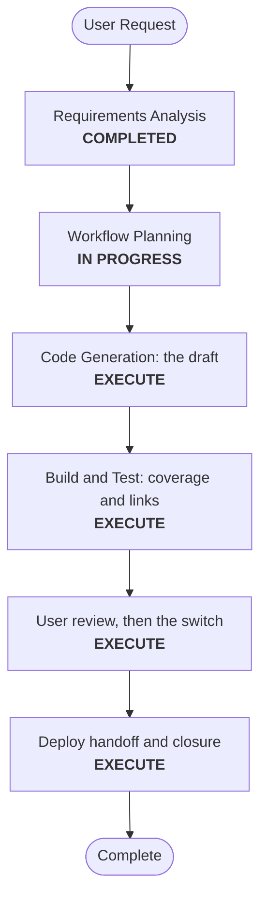

# Execution Plan — Documentation Restructure

## Analysis
- **Type**: documentation only (no code, configuration or behavior change). **Risk**: low; the current README stays until the user approves the switch.

## Workflow

Text alternative: Requirements Analysis is done; Workflow Planning leads to Code Generation (the draft), Build and Test (coverage and links), the user's review followed by the switch, and the Deploy handoff with closure.

## Phases
- User Stories, Application Design, Units, Functional Design, NFR, Infrastructure Design: SKIP (no software design; the page structure is fixed in FR-2 to FR-6).
- **Code Generation**: write `README.draft.md` and `docs-draft/` (landing page with the Mermaid diagram; components; four journeys; reference pages; evolution).
- **Build and Test**: a coverage table mapping every current README section and limitation to its new place (FR-7); relative links checked by a script; Mermaid validated; every page's audience line and back link (NFR-1).
- **Review and switch**: after the user's approval, move the draft into place (`README.md`, `docs/`), update the links that point at README anchors (tests, scripts, canonical knowledge), and rerun the checks.
- **Deploy**: a handoff (no environment change); then closure.

## Canonical Knowledge Impact Inventory
| Path | Action | Reason |
|---|---|---|
| `aidlc-docs/knowledge/opensource-lakehouse-infra/application-design.md` | UPDATE | "Operational entry points" points to the new docs structure |
| other canonical documents | RETAIN | Content unchanged |
