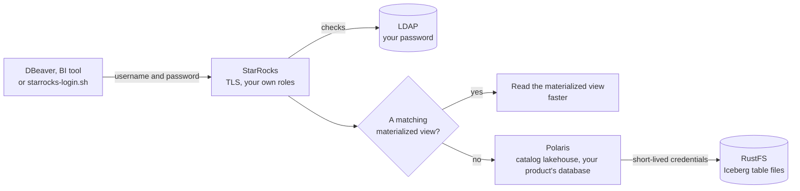

# Data analyst and BI user journey

For a product's analysts and BI users (group `role-<product>-analyst`, for example `peter-analyst` in `role-default-analyst`): querying the product's tables with SQL from the command line, DBeaver, or a BI tool. Back to the [README](../../README.md).

Your default access: read the product's production tables and materialized views; nothing in UAT or dev ([access levels](../components.md#access-levels)). You may also use JupyterHub ([JupyterHub](../reference/jupyterhub.md)).

## Journey at a glance



Text alternative: you connect from DBeaver, a BI tool or `starrocks-login.sh` with your username and password over TLS; StarRocks checks the password in LDAP and applies your own roles. For each query, StarRocks uses a matching materialized view when there is one, which is faster; otherwise it reads the Iceberg tables of your product's database through Polaris, which grants short-lived credentials to the table files in RustFS.

## 1. Log in to StarRocks

Use your own username and password, the same as for Keycloak sign-in. **Every connection must use TLS** (plain-text connections are refused).

```sh
./scripts/clients/starrocks-login.sh peter-analyst                     # asks for the password
./scripts/clients/starrocks-login.sh peter-analyst -e "SHOW CATALOGS"
```

## 2. Connect DBeaver or a BI tool

1. **DBeaver**: create a **StarRocks** connection to host `127.0.0.1`, port `9030`, with your username and password; on the **SSL** tab, enable SSL (or set the driver property `sslMode=REQUIRED`).
2. **Other JDBC and BI clients** (MySQL Connector/J, or ODBC, for example Power BI): username and password, with `sslMode=REQUIRED`. The client sends the password with the MySQL clear-text authentication plugin, which these drivers use only over TLS.
3. **Optional, verify the certificate**: import the CA and use `sslMode=VERIFY_IDENTITY` ([StarRocks — certificate](../reference/starrocks.md#verify-the-certificate)).

## 3. Find the tables

- Leave the connection's default database empty: the session starts in `default_catalog`. Its databases `default_lh`, `default_lhuat` and `default_lhdev` are the products' **materialized-view databases**, not the Iceberg namespaces.
- The Iceberg tables are in the catalogs `lakehouse` (prod), `lakehouse_uat` and `lakehouse_dev`, one database per product namespace. Browse them, or use fully qualified names:

  ```sql
  SHOW TABLES FROM lakehouse.default_lh;
  SELECT * FROM lakehouse.default_lh.tpch_region;
  ```

- You see only the databases and tables your roles grant; other products' tables stay hidden.
- **DBeaver tree**: DBeaver may show one catalog's databases under another catalog's node. Refresh the node (F5), reconnect and expand the catalog first, or use one connection per catalog (for example `jdbc:mysql://127.0.0.1:9030/lakehouse.default_lh`).

## 4. Faster queries through materialized views

You don't query materialized views directly: StarRocks rewrites a query on the tables to read a matching materialized view when one exists, so the same SQL runs faster ([how it works](../components.md#materialized-views-and-query-acceleration)). Developers author the views ([developer journey](data-product-developer.md#7-accelerate-queries-with-materialized-views)).

## 5. When something fails

| Symptom | Meaning |
|---|---|
| "empty password is not allowed for simple authentication" | StarRocks restarted; logins recover within five minutes (ask the platform admin to fix it at once) |
| Access denied on a table | Your role doesn't include that environment or product; ask the product owner |
| A new product's tables are missing | They appear within about five minutes after the product is created |
| Login refused for everyone | LDAP may be down; ask the platform admin |
