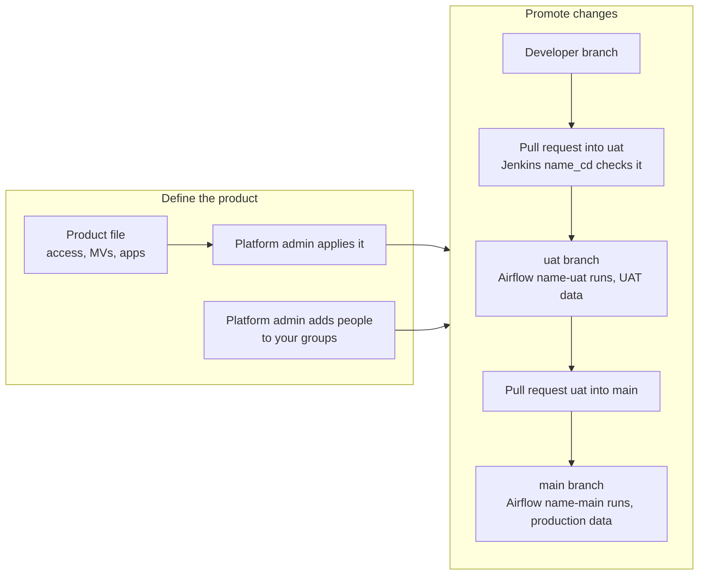

# Data product owner journey

For a product's owners (group `role-<product>-owner`, for example `maria-owner` in `role-default-owner`): what you own, who gets which access, and how changes reach production. Back to the [README](../../README.md).

How access is secured: [Security](../security.md).

## Journey at a glance

Text alternative: you define the product in its file (access levels, materialized views, apps), and the platform admin applies it and adds people to your groups. Changes then move through the repository: a developer's branch, a pull request into `uat` checked by Jenkins `<product>_cd`, the `uat` branch running in Airflow's `<product>-uat` bundle against UAT data, a pull request from `uat` into `main`, and the `main` branch running in `<product>-main` against production data.

## 1. What you own

Your product is one file, `data-products/<product>.yaml` ([format](../components.md#data-products)). With the `manage` level in every environment you have:

| Where | Your rights |
|---|---|
| Polaris and RustFS | manage your three namespaces and buckets (prod, UAT, dev) |
| StarRocks | `ALL` on your product's databases, and manage its materialized-view databases |
| Jenkins | admin of your product's folder (jobs, runs, views, folder credentials) |
| Airflow | `User` (run, pause, and clear DAGs, read logs) |
| Keycloak | none: group membership is changed by the platform admin |

You cannot create or drop namespaces, and you cannot drop Iceberg tables through StarRocks (use Spark or Polaris; see [Known limitations](../reference/limitations.md)). The product file itself is applied by the platform admin ([platform admin journey](platform-admin.md#3-create-change-or-remove-a-data-product)).

## 2. Decide who gets which access

The file's `access`, `materialized_views` and `apps` blocks set what each role can do; the defaults:

| Role | Data | Materialized views | JupyterHub | Airflow | Jenkins folder |
|---|---|---|---|---|---|
| owner | manage all environments | manage | — | User | admin |
| developer | read prod and UAT; read and write dev | author in dev; read prod and UAT | yes | User | read and build |
| analyst | read prod | read prod | yes | User | read |
| writer (service user for runs) | read and write all | author in all | — | Viewer | — |

- **Changing a level**: edit the file and ask the platform admin to apply it; removed grants are revoked. [Access levels](../components.md#access-levels) explains what read, write and manage mean in each system.
- **People**: the platform admin adds people to your groups in Keycloak. Polaris and StarRocks follow within five minutes; JupyterHub, Airflow and Jenkins at the next sign-in.
- **Checking**: `python3 scripts/verify/role-matrix.py --product <product>` (run by the platform admin) tests every role, including that none reaches another product.

## 3. Your repository and how changes reach production

With a `repo` block, your product has a Git repository (read anonymously, so it must be public) that holds its workflows, notebooks and configs:

1. Developers work on a branch and open a **pull request into `uat`**. Jenkins `<product>_cd` validates and tests the branch.
2. Merging into the **UAT branch** makes Airflow show `<product>-uat-<workflow>` within about five minutes; run it there.
3. A **pull request from `uat` into `main`** (the prod branch), once merged, gives `<product>-main-<workflow>`.

Airflow runs always write as your product's writer (`srv-<product>-writer`) in the environment of their bundle (`-main` is prod, `-uat` is UAT). Jenkins and Airflow details: [Jenkins](../reference/jenkins.md), [Airflow](../reference/airflow.md). The repository's own structure: the [developer journey](data-product-developer.md).

## 4. Keep an eye on

- **Materialized views keep their author**: if the author leaves every product group, a view may stop refreshing, and you must re-create it.
- **Checkpoint keys** are shared per product environment, not per person ([Streaming checkpoints](../reference/streaming-checkpoints.md)).
- **Platform-wide Airflow rights**: Airflow roles apply to all of Airflow, not just your product.
