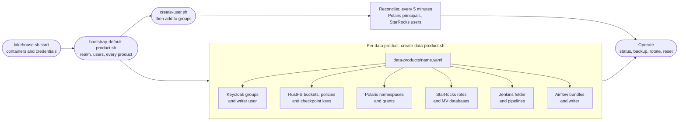

# Platform admin journey

For `platform-admin` (group `role-platform-admin`): starting the platform, creating data products and users, and operating it. Back to the [README](../../README.md).

How access is secured: [Security](../security.md).

## Journey at a glance



Text alternative: start the containers, then run the product bootstrap, which creates the realm, the users and every product. Each product file, applied with `create-data-product.sh`, creates or updates the product's Keycloak groups and writer user, RustFS buckets, policies and checkpoint keys, Polaris namespaces and grants, StarRocks roles and MV databases, Jenkins folder and pipelines, and Airflow bundles. New users are created and added to groups; the reconciler carries group changes to Polaris and StarRocks. Then you operate the platform: status, backup, rotation and reset.

## 1. Start the platform

```sh
cp .env.example .env                    # first time only
./scripts/lakehouse.sh start            # 1. start core and the enabled modules
./scripts/bootstrap-default-product.sh  # 2. create realm, users, and every data product
./scripts/lakehouse.sh start-airflow    # optional: Airflow
```

- **Step 1** creates missing credentials under `.runtime/credentials/` and starts the containers. It never changes realm, users, buckets, or catalogs.
- **Step 2** reruns step 1, then creates the Keycloak realm, clients, and [bootstrap users](../reference/identity.md#bootstrap-users), and every [data product](../components.md#data-products) in `data-products/` (at first only `default`):
  - Keycloak groups
  - buckets and storage policies (and checkpoint keys)
  - Polaris catalogs, namespaces, and grants
  - Spark smoke tables
  - StarRocks catalogs, roles, and users
- Both steps are safe to rerun, and existing data is preserved. Requirements: an arm64 machine (Apple silicon; [why](../reference/limitations.md)), Docker with Compose V2, Python 3, and OpenSSL; StarRocks needs about 6 GB of memory. To turn modules off, see [Compose modules](../components.md#compose-modules).
- Each bootstrap step can also run on its own: [Running bootstrap steps individually](../reference/operations.md#running-bootstrap-steps-individually).

## 2. Sign in and administer the realm

| To do this | Go to | As |
|---|---|---|
| Administer the `lakehouse` realm (users, groups, clients) | <http://keycloak.localhost:8080/admin/lakehouse/console/> | `platform-admin` |
| Administer Keycloak itself (the `master` realm, server settings) | <http://127.0.0.1:8080/admin/> | `admin`, with the password in `.runtime/credentials/keycloak-admin-password` |

As `platform-admin` you are owner of every product, StarRocks system admin, Hub admin in JupyterHub, `Admin` in Airflow, and you administer all of Jenkins. Restoring the bootstrap users and other identity details: [Identity](../reference/identity.md).

## 3. Create, change, or remove a data product

```sh
./scripts/operations/create-data-product.sh --init sales                       # write data-products/sales.yaml
./scripts/operations/create-data-product.sh data-products/sales.yaml --dry-run # show the plan
./scripts/operations/create-data-product.sh data-products/sales.yaml           # apply it
```

- **Applying** creates what is missing and makes every component match the file:
  - Keycloak groups and roles, the writer user (password `ChangeM3!`, in its password file), and the platform-admin owner role
  - buckets, storage policies, and checkpoint keys
  - Polaris namespaces and grants
  - StarRocks roles and MV databases
  - the Jenkins folder and its permissions, and the `<name>_ci` and `<name>_cd` jobs when the file has a `repo` block
  - the Airflow bundles and writer, when the file has a `repo` block
- **Changing**: edit the file and apply it again. Access levels and app mappings can change at any time, and removed grants are revoked. **Names are locked once applied**: to rename a bucket, namespace, group, or the writer user, remove the product and create it again.
- **Restarts**: Jenkins, when its folders, jobs, or permissions change, and Airflow, when the bundles or writers change (a `repo` block added, edited, or removed). Airflow is recreated with `scripts/lakehouse.sh start-airflow` only if it is running; otherwise its next start picks the change up. `--no-restart` prints the commands instead, and `--dry-run` lists the Jenkins folders and jobs to create or delete and the bundles Airflow would get. Removing the `repo` block deletes the product's two Jenkins jobs and their build history; its folder stays. Sign-in roles need no restart: JupyterHub and Airflow read the files at each sign-in.
- **StarRocks delay**: a new product's tables become readable through StarRocks within about five minutes, when the shared catalogs renew their Polaris token and pick up the new writer group. Polaris, Spark, and the apps work right away.
- **Credentials**: the script signs in to Keycloak as a platform administrator and refuses users outside `role-platform-admin`. Pass `--admin-user USER` (default `platform-admin`) and `--admin-password-file FILE`, or set `LAKEHOUSE_ADMIN_PASSWORD`; otherwise it asks for the password without echo. The other services use the protected bootstrap credentials.
- **Safe to rerun**: a failed apply can simply be run again. One create or remove runs at a time.
- **Checking access**: `python3 scripts/verify/role-matrix.py --product sales` tests every role with temporary identities, including that it cannot reach other products. It creates the product's smoke tables if they are missing.

**Remove a product:**

```sh
./scripts/operations/remove-data-product.sh sales --dry-run
./scripts/operations/remove-data-product.sh sales                # stops if the product still holds data
./scripts/operations/remove-data-product.sh sales --purge-data   # also deletes its tables and objects
```

- **Never `default`**: the default product cannot be removed.
- **Data check**: it lists the product's tables, MVs, and bucket objects, and the members who will lose access. It stops while any data exists, unless you pass `--purge-data`.
- **Confirmation**: you type the product name (`--yes` skips this, for scripts). It takes the same admin credentials as the create script.
- **What goes**: the Jenkins folder (with its jobs and build history) and entries, StarRocks roles and MV databases, Polaris roles and namespaces, checkpoint keys, buckets and policies, the Keycloak groups and writer user, and finally the product file. Its Airflow bundles go last (Airflow is recreated, as for create). The file and its applied state are backed up to `.runtime/backups/<time>-remove-<name>/` first.
- **Users stay**: only their memberships go. A failed removal can be rerun with the same command.

The file format and access levels: [Data products](../components.md#data-products). Handing a product to its owner: the [data product owner journey](data-product-owner.md).

## 4. Add users

```sh
./scripts/operations/create-user.sh anna --email anna@example.com --first-name Anna --last-name Lee
```

- **The user**: enabled in the `lakehouse` realm with the permanent password `ChangeM3!`, or the first line of `--password-file FILE`. No groups, and an existing username is refused.
- **Stored in LDAP**: Keycloak writes the new user and its password to the LDAP directory, so the same password works for StarRocks once the user is in a product group.
- **Credentials**: as for the product scripts, `--admin-user` and `--admin-password-file`, `LAKEHOUSE_ADMIN_PASSWORD`, or a prompt.
- **Access**: add the user to product groups in the [Keycloak admin console](http://keycloak.localhost:8080/admin/lakehouse/console/) as `platform-admin`. Polaris and StarRocks follow within five minutes, or right away with `python3 infra/polaris/reconcile-keycloak-groups.py` and `./scripts/lakehouse.sh reconcile-starrocks`. JupyterHub, Airflow, and Jenkins follow at the next sign-in.

## 5. Operate

| Task | Where |
|---|---|
| Status and stop (`status` also shows the scheduled `reconciler`) | [Operations — status and stop](../reference/operations.md#status-and-stop) |
| Reset everything | [Operations — reset](../reference/operations.md#reset-the-platform) |
| Backup | [Operations — backup](../reference/operations.md#backup) |
| Secrets and rotation (client secrets, LDAP, checkpoint keys) | [Operations — secrets](../reference/operations.md#secrets-and-rotation) |
| Change the workload Python packages | [Workload Python environment](../reference/workload-python.md#changing-it) |
| Moving an older stack to LDAP | [Identity — migration](../reference/identity.md#moving-an-existing-stack-to-ldap) |
| Change the platform itself (code, configuration, components) | [AI-DLC: the change workflow](../reference/aidlc.md) |

## 6. Troubleshoot

| Symptom | Cause and fix |
|---|---|
| StarRocks password logins fail with "empty password is not allowed for simple authentication" | The FE restarted and lost its LDAP bind pattern; the scheduled cycle restores it within five minutes, or run `python3 infra/starrocks/reconcile-starrocks-users.py --bind-pattern-only` ([StarRocks — users](../reference/starrocks.md#users)) |
| `./scripts/lakehouse.sh status` shows `reconciler ... (unhealthy)` | No cycle fully succeeded for two intervals plus a minute; `docker logs lakehouse-local-polaris-group-reconciler-1` says why |
| Group changes don't reach Polaris or StarRocks | Run `python3 infra/polaris/reconcile-keycloak-groups.py` and `./scripts/lakehouse.sh reconcile-starrocks` |
| An Airflow run fails at `create_cluster` with `unknown_product`, `unknown_dag` or `bundle_mismatch` | The DAG ID or bundle doesn't match the product ([Airflow — which writer](../reference/airflow.md#runs-and-the-writer)) |
| An Airflow run fails at `create_cluster` because `local/lakehouse-spark-runtime` is missing | Images were pruned; run `scripts/lakehouse.sh start-airflow` ([Known limitations](../reference/limitations.md)) |
| Tasks killed with exit 137, or a Jupyter kernel dies | Out of memory: a run's tasks share one Spark container, and a Jupyter server has 2 GiB; order tasks with `runs_after`, shut down idle kernels ([Known limitations](../reference/limitations.md)) |
| Polaris reports `Read timed out` from storage | Check `docker ps` for RustFS `unhealthy`; restart it with `docker compose -f compose.core.yml restart rustfs` (data is kept) |
| RustFS console bucket list keeps reloading | Upstream bug; open a bucket directly ([Known limitations](../reference/limitations.md)) |
| Keycloak is down and you need Jenkins | Use `jenkins-break-glass` ([Jenkins](../reference/jenkins.md#configuration)) |
