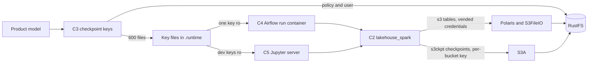

# Component Dependencies — Spark S3 Checkpoints

## Matrix
| From \ To | Product model | RustFS admin API | Key files | C2 lakehouse_spark | S3A (C1) |
|---|---|---|---|---|---|
| C3 checkpoint keys | reads buckets | writes policy, user | writes | — | — |
| C4 factory | reads bucket of run | — | mounts one | — | — |
| C5 spawner | reads groups → products | — | mounts dev set | — | — |
| C2 session | — | — | reads | — | configures |
| Spark job | — | — | — | calls | uses for `s3ckpt://` |

## Data flow

Text alternative: the product model drives C3, which creates RustFS policies and users and writes key files. The Airflow factory mounts one key into each run container, and the Hub mounts the user's dev keys into the Jupyter server. `lakehouse_spark` reads the mounted keys. Table data goes through Polaris-vended credentials, and checkpoints go through S3A with the per-bucket key; both reach RustFS.

## Communication
- C3 → RustFS: signed admin API over the internal network with the root key, from the host only (as `bootstrap-policies.py` does today).
- Airflow and Hub → key files: read-only folder mount for validation; bind mounts by host path into the containers they start (the broker CA pattern).
- Spark → RustFS: S3 over HTTP on the data network, as today for vended access.

## Coupling notes
- The key file name equals the bucket name; C2 needs no product knowledge.
- Moving to STS later replaces C3, C4 and C5's key handling and C2's credential settings only; products' `checkpoint_path` and notebooks are unchanged.
