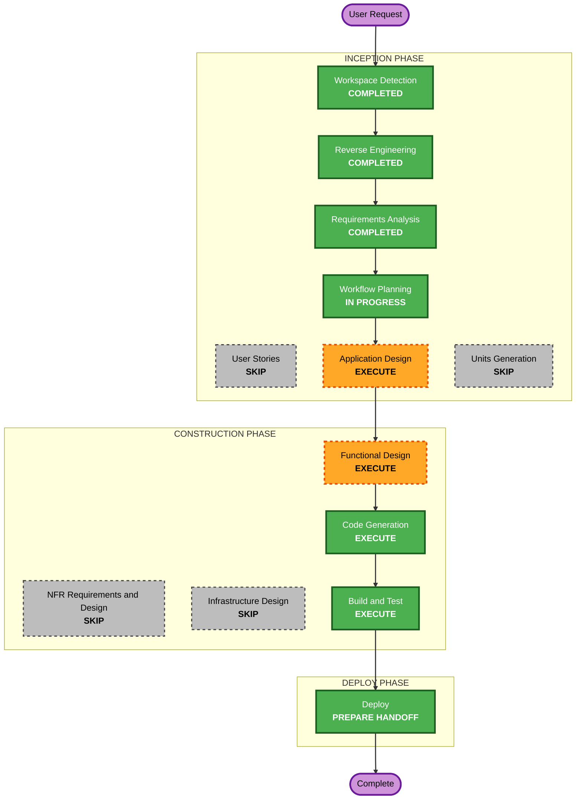

# Execution Plan — Spark S3 Checkpoints

## Detailed Analysis Summary
- **Transformation type**: a new storage-credential path for Spark (STS with the job's own token), an S3 filesystem in the Spark images, and RustFS policy additions; no new service.
- **Impact**: both images rebuilt; the Java token provider gains a Hadoop credential provider; RustFS policies gain checkpoint statements; possibly Keycloak token claims for STS (probe); product contract gains `checkpoint_path`.
- **Risk**: high (security-relevant, new credential path; RustFS STS behavior with Keycloak tokens unproven).
  - **Not yet proven**: RustFS 1.0.4 `AssumeRoleWithWebIdentity` with the writer and user tokens (audience, signature, `groups` claim) and its policy mapping; adding checkpoint statements without widening console access; S3A with RustFS (path style, `s3://` mapped to S3A) and Iceberg's streaming source on an S3 checkpoint.
- **Rollback**: rebuild the images without S3A; remove the policy statements; Iceberg access is unaffected throughout.

## Workflow Visualization

Text alternative: the completed inception stages lead to Application Design, Functional Design, Code Generation, Build and Test, and the Deploy handoff; User Stories, Units Generation, NFR and Infrastructure Design are skipped.

## Phases
- [ ] User Stories: SKIP. Internal platform capability; the consumers (data engineers) are known.
- [ ] Application Design: **EXECUTE**, probes first: RustFS STS with the writer and a user token; the policy mapping; S3A with RustFS; Iceberg streaming on an S3 checkpoint with temporary credentials. Then the components: S3A libraries and settings, the credential provider, RustFS policies, possible Keycloak token-claim changes, the verifier.
- [ ] Units Generation: SKIP. One unit, `s3-checkpoints`.
- [ ] Functional Design: **EXECUTE**. Policy statements per identity and environment, credential lifetime and renewal, failure behavior, the product contract, the verifier's matrix, and properties.
- [ ] NFR Requirements, NFR Design: SKIP. The security NFRs are stated (NFR-1 to NFR-5) and enforced through the Security Baseline at each stage.
- [ ] Infrastructure Design: SKIP. No new service, network or volume.
- [ ] Code Generation: **EXECUTE**. Images, the provider (Java), policies, settings, verifier, tests, README.
- [ ] Build and Test: **EXECUTE**. Image builds and checksum verification; the verifier's matrix; a resumed stream in an Airflow run and in Jupyter; the existing suites; then the paused tpch intent resumes.
- [ ] Deploy: **EXECUTE**, as a handoff.

## Canonical Knowledge Impact Inventory
| Canonical path | Action | Requirement | Reason |
|---|---|---|---|
| `aidlc-docs/knowledge/opensource-lakehouse-infra-v2/application-design.md` | UPDATE | FR-1 to FR-4 | The Spark storage model gains ResolvingFileIO, `s3ckpt://` and per-bucket checkpoint keys next to Polaris vending; a bounded exception to "no static RustFS credentials" (CR-1) |
| `aidlc-docs/knowledge/opensource-lakehouse-infra-v2/functional-design/lakehouse-product-access.md` | UPDATE | FR-3, FR-4 | RustFS policies and the access matrix gain checkpoint access per role and environment |
| `aidlc-docs/knowledge/opensource-lakehouse-infra-v2/functional-design/workload-python-environment.md` | UPDATE | FR-1, FR-5 | Spark session settings (S3A) and the `checkpoint_path` contract for workload code |
| `aidlc-docs/knowledge/opensource-lakehouse-infra-v2/functional-design/airflow-workflows.md` | UPDATE (CR-1) | FR-4 | The run container mounts the run's checkpoint key |
| `aidlc-docs/knowledge/opensource-lakehouse-infra-v2/functional-design/jenkins-ci-access.md` | RETAIN | none | Unaffected |
| `aidlc-docs/knowledge/opensource-lakehouse-infra-v2/functional-design/starrocks-sql-access.md` | RETAIN | none | Unaffected |

## Security Compliance (Workflow Planning)
All rules marked Required in requirements.md are carried into Application Design (probes and components) and Functional Design (policy statements, lifetimes, failure behavior); no artifact of this stage creates a policy, credential or network rule. No blocking findings.
