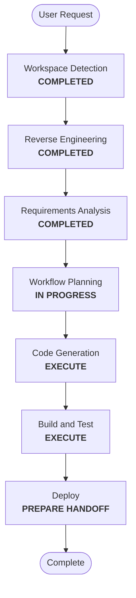

# Execution Plan — StarRocks Metadata Access

## Detailed Analysis Summary
- **Transformation type**: a fix inside one existing component (StarRocks role enforcement in `infra/starrocks/bootstrap-starrocks.py`), plus docs.
- **Impact**: every managed product role gains one grant per catalog where it has `USAGE`; SQL clients' metadata queries work; no data access changes.
- **Risk**: low. The probe showed the grant is accepted and that `information_schema` rows are filtered by privileges.
- **Rollback**: revert the code and revoke the grant (the bootstrap's revocation of uncovered privileges does that on its next run).

## Workflow Visualization

Text alternative: Workspace Detection, Reverse Engineering and Requirements Analysis are completed; Workflow Planning leads to Code Generation, Build and Test, and the Deploy handoff. User Stories, Application Design, Units Generation, Functional Design and the NFR and Infrastructure stages are skipped.

## Phases
- [ ] User Stories: SKIP (one internal fix).
- [ ] Application Design: SKIP (no new component or interface; the grant joins the existing level model).
- [ ] Units Generation: SKIP (one unit, `metadata-grant`).
- [ ] Functional Design: SKIP (the rule is fully stated in FR-1 and FR-2; the canonical design is updated at closure).
- [ ] NFR Requirements, NFR Design, Infrastructure Design: SKIP (security rules are enforced through the Security Baseline in Code Generation and Build and Test).
- [ ] Code Generation: **EXECUTE**: the grant in the bootstrap's desired privileges, tests (example and property), README section.
- [ ] Build and Test: **EXECUTE**: host tests; the bootstrap applied live and idempotent; DBeaver's query as a temporary user with a product role in each catalog; the cross-product check with temporary roles; a user check in DBeaver.
- [ ] Deploy: **EXECUTE** as a handoff.

## Canonical Knowledge Impact Inventory
| Canonical path | Action | Requirement | Reason |
|---|---|---|---|
| `aidlc-docs/knowledge/opensource-lakehouse-infra-v2/functional-design/starrocks-sql-access.md` | UPDATE | FR-1, FR-2, FR-4, FR-5 | The levels gain the `information_schema` grant; SQL-client guidance |
| `aidlc-docs/knowledge/opensource-lakehouse-infra-v2/application-design.md` | RETAIN | none | StarRocks' architecture is unchanged |
| other functional designs | RETAIN | none | Unaffected |

## Security Compliance (Workflow Planning)
The Required rules (SECURITY-06, 08, 11, 15) are carried into Code Generation and Build and Test; no blocking findings.
