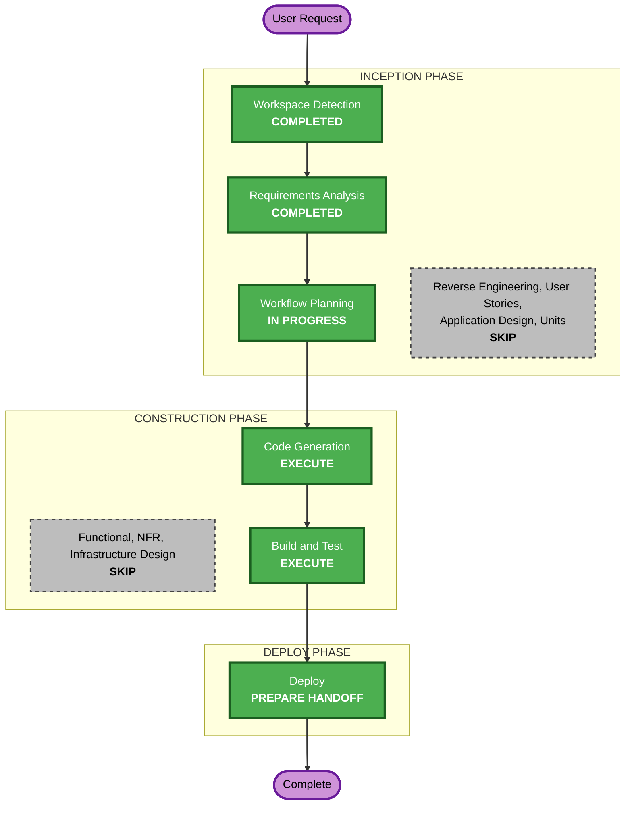

# Execution Plan — Workflow Subprojects

## Detailed Analysis Summary
- **Transformation type**: an extension of the platform DAG factory's workflow rules (`lakehouse_dags.spec`) and one call in `factory.py`; no new component, service, image or configuration.
- **Impact**: product repositories may group workflows and code by subproject; flat repositories are unchanged (FR-4). DAG and task IDs unchanged.
- **Risk**: low. The package is mounted read-only, so the change takes effect on `start-airflow`; rollback is reverting the two files.

## Workflow Visualization

Text alternative: Workspace Detection and Requirements Analysis are completed; Workflow Planning leads to Code Generation, Build and Test, and the Deploy handoff; the design stages are skipped.

## Phases
- [ ] Reverse Engineering, User Stories, Application Design, Units Generation: SKIP. The component exists (canonical `airflow-workflows.md`); no new component or interface beyond `Workflow.project` and `entrypoint_path`.
- [ ] Functional, NFR, Infrastructure Design: SKIP. The rules are fully stated in FR-1 to FR-3.
- [ ] Code Generation: **EXECUTE** (unit `subprojects`): review the drafted `spec.py` and `factory.py`; tests (examples and Hypothesis); README.
- [ ] Build and Test: **EXECUTE**: host and Airflow-image suites; `start-airflow` with no active run; the current flat `sample-dp` keeps its DAGs; then, after the user approves the workload push (outside this intent), the moved layout loads the same DAG IDs, a UAT run passes, and Jenkins validates it.
- [ ] Deploy: **EXECUTE**, as a handoff.

## Canonical Knowledge Impact Inventory
| Canonical path | Action | Requirement | Reason |
|---|---|---|---|
| `aidlc-docs/knowledge/opensource-lakehouse-infra-v2/functional-design/airflow-workflows.md` | UPDATE | FR-1 to FR-3 | Workflow file locations, entry-point resolution, unique names, the validator's new problems |
| `aidlc-docs/knowledge/opensource-lakehouse-infra-v2/application-design.md` | UPDATE | FR-1 | The workload contract sentence ("declares DAGs only in `workflows/<name>.json`") |
| `aidlc-docs/knowledge/opensource-lakehouse-infra-v2/functional-design/jenkins-ci-access.md` | RETAIN | none | The validator wrapper is unchanged |
| `aidlc-docs/knowledge/opensource-lakehouse-infra-v2/functional-design/workload-python-environment.md` | RETAIN | none | Unaffected |
| `aidlc-docs/knowledge/opensource-lakehouse-infra-v2/functional-design/lakehouse-product-access.md` | RETAIN | none | DAG IDs unchanged |
| `aidlc-docs/knowledge/opensource-lakehouse-infra-v2/functional-design/starrocks-sql-access.md` | RETAIN | none | Unaffected |

## Success Criteria
- Flat and subproject layouts both load; entry points resolve in the subproject folder; duplicate names are refused; the moved `sample-dp` keeps `default-*-test_environment` and `default-*-generate_tpch`; suites pass.
