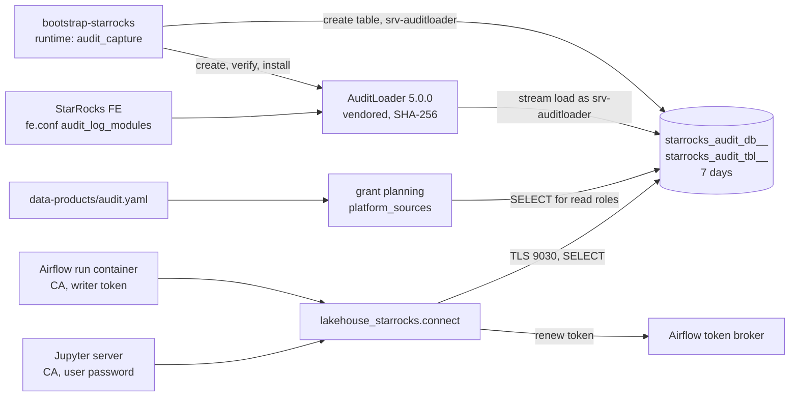

# Component Dependencies — StarRocks Audit Capture

Text alternative: the runtime bootstrap creates the staging table and the loader user, verifies the vendored AuditLoader package and installs it into the FE; the FE, with `audit_log_modules` set, hands audit events to the plugin, which stream-loads them as `srv-auditloader`. Product files with `platform_sources` drive the grant planning, which grants `SELECT` on the staging table to the declared roles. Workload code in Airflow run containers and Jupyter servers calls `lakehouse_starrocks.connect()`, which renews the writer token through the broker (Airflow) or asks the user's password (Jupyter), and reads the staging table over TLS.

## Contracts
| Contract | Producer | Consumer |
|---|---|---|
| Staging table `starrocks_audit_db__.starrocks_audit_tbl__`: AuditLoader columns, UTC `timestamp`, `queryType` in `query`, `slow_query`, `connection`, `disconnection`; 7 days | C1, plugin | the audit product's bronze task (`SELECT *`) |
| `platform_sources.starrocks_audit.<role>: none|read` | product files | C5 grant planning |
| Environment: `LAKEHOUSE_STARROCKS_HOST`, `LAKEHOUSE_STARROCKS_PORT`, `LAKEHOUSE_STARROCKS_CA`, `LAKEHOUSE_STARROCKS_USER` (Airflow only); existing `LAKEHOUSE_TOKEN_PROVIDER`, `LAKEHOUSE_INITIAL_ACCESS_TOKEN`, `LAKEHOUSE_TOKEN_BROKER_URL`, `LAKEHOUSE_TOKEN_BROKER_CA`, `LAKEHOUSE_RUN_HANDLE`, `LAKEHOUSE_RUN_CAPABILITY`, `JUPYTERHUB_USER` | C9, C10 | C7 |
| `lakehouse_starrocks.connect() -> DB-API connection` | C7 | product code (`opensource-lakehouse-audit-dp` bronze) |

## Dependency matrix
| Component | Depends on |
|---|---|
| C1 | `starrocks_common` runner, root password, `.runtime/credentials`, C2, the FE's read-only `.runtime/starrocks-audit` mount |
| C5 | C4, C1 (table exists) |
| C7 | PyMySQL (C8), broker (Airflow), CA and variables (C9, C10) |
| Audit product bronze | C7, C5 grant, C1 table |
