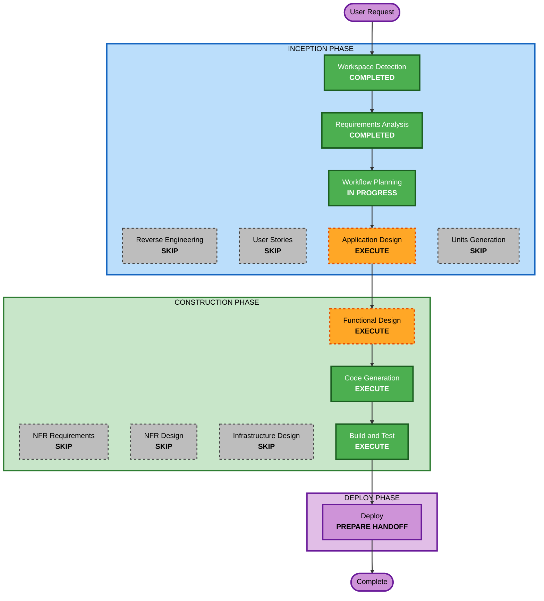

# Execution Plan — StarRocks Audit Capture

Intent `20261125-starrocks-audit-capture`. Inputs: [requirements.md](../requirements/requirements.md) (approved 2026-11-25), canonical knowledge `aidlc-docs/knowledge/opensource-lakehouse-infra/`.

## Detailed Analysis Summary

### Transformation Scope
- **Type**: new platform capability inside existing components; no new service or container.
- **Primary changes**: StarRocks bootstrap gains audit capture (staging table, loader user, plugin lifecycle); the product model gains `platform_sources` and its StarRocks grant; the workload Python set gains `lakehouse_starrocks` and PyMySQL; Airflow run containers and Jupyter servers get the StarRocks CA and address.
- **Related components**: `infra/starrocks/` (bootstrap, common), `infra/products/` (`data_products.py`, `template.yaml`), `infra/workload-python/` (module, `requirements.in`, lock), `infra/airflow/lakehouse_dags/factory.py`, `infra/jupyter/hub/` (spawner), `scripts/lakehouse.sh` (status), Spark runtime and Jupyter images (rebuilt for the lock), `data-products/audit.yaml`, docs, tests.

### Change Impact Assessment
- **User-facing changes**: Yes. Audit owners and developers can query the staging table; `lakehouse_starrocks.connect()` for workload code; `status` shows audit capture.
- **Structural changes**: Small. A new optional product-file block; a new workload module.
- **Data model changes**: Yes. The staging table (StarRocks internal); product-file schema (`platform_sources`).
- **API changes**: Yes. `lakehouse_starrocks.connect()` (consumed by the audit product's bronze task); new environment variables in run containers and Jupyter servers.
- **NFR impact**: Yes. A new service credential, a downloaded plugin running inside the FE, new grants (Security Baseline).

### Component Relationships
| Component | Change | Reason | Priority |
|---|---|---|---|
| StarRocks bootstrap (`infra/starrocks/`) | Major | Capture: table, user, plugin | Critical |
| Product model (`infra/products/data_products.py`, template, StarRocks grant planning) | Minor | `platform_sources` and its grant | Critical |
| Workload Python (`infra/workload-python/`) | Minor | `lakehouse_starrocks`, PyMySQL in the lock | Critical |
| Airflow DAG factory | Minor | CA mount and StarRocks environment in run containers | Critical |
| JupyterHub spawner | Minor | CA mount and StarRocks environment in user servers | Important |
| Images (Spark runtime, Jupyter single-user) | Rebuild | New lock | Critical |
| `scripts/lakehouse.sh status` | Minor | Capture health | Important |
| Docs, `data-products/audit.yaml` | Minor | Q6 | Important |

### Risk Assessment
- **Risk level**: Medium. The StarRocks bootstrap runs on every start; a plugin fault could affect the FE; the plugin comes from outside.
- **Rollback**: moderate. Uninstall the plugin, drop the staging database and the loader user, remove the `platform_sources` block; the new module is unused without a caller.
- **Testing complexity**: moderate. Pure functions unit-tested; the plugin, grants and logins need live checks on the running platform.

## Workflow Visualization



### Text alternative
```text
INCEPTION:    Workspace Detection (COMPLETED) -> Reverse Engineering (SKIP)
              -> Requirements Analysis (COMPLETED) -> User Stories (SKIP)
              -> Workflow Planning (IN PROGRESS) -> Application Design (EXECUTE)
              -> Units Generation (SKIP; units listed below)
CONSTRUCTION: per unit U1, U2, U3: Functional Design (EXECUTE) -> Code Generation
              NFR Requirements, NFR Design, Infrastructure Design (SKIP)
              -> Build and Test (EXECUTE, includes live checks)
DEPLOY:       Deploy handoff (PR request, deploy instructions)
```

## Phases to Execute

### INCEPTION PHASE
- [x] Workspace Detection (COMPLETED)
- [x] Reverse Engineering (SKIPPED) — canonical knowledge current.
- [x] Requirements Analysis (COMPLETED, approved 2026-11-25)
- [x] User Stories (SKIPPED) — platform plumbing for one known consumer.
- [x] Execution Plan (IN PROGRESS)
- [ ] Application Design — EXECUTE
  - **Rationale**: new interfaces between components: the plugin lifecycle in the bootstrap and its pinned artifact, the `platform_sources` schema and how it reaches the StarRocks grant model, the `lakehouse_starrocks` contract and the environment variables Airflow and JupyterHub set. Settles probe P-1 (the plugin release and its DDL) before code.
- [ ] Units Generation — SKIP
  - **Rationale**: the units follow existing component boundaries: **U1 `starrocks-audit-capture`** (StarRocks bootstrap, status), **U2 `product-platform-sources`** (product model, grants, `audit.yaml`), **U3 `workload-starrocks-connection`** (workload module and lock, Airflow factory, JupyterHub spawner, images). Runtime order U1 then U2 (the grant needs the table); U3 independent.

### CONSTRUCTION PHASE
- [ ] Functional Design — EXECUTE, one consolidated design for the three units (they are small)
  - **Rationale**: rules for the plugin lifecycle (cache, verify, render, install, reinstall), the schema and grant rules, the token renewal and login rules; PBT-01 property identification; security misuse cases.
- [ ] NFR Requirements — SKIP
  - **Rationale**: the stack is fixed by the platform; Security Baseline rules are applied in Application Design, Functional Design and Code Generation; PBT framework Hypothesis (already used here).
- [ ] NFR Design — SKIP (NFR Requirements skipped).
- [ ] Infrastructure Design — SKIP
  - **Rationale**: no new service, network or volume; the two new mounts and variables are interface details settled in Application Design.
- [ ] Code Generation — EXECUTE (ALWAYS), U1, U2, U3, then docs
- [ ] Build and Test — EXECUTE (ALWAYS): unit tests, lint, image rebuilds, image vulnerability scan (supply-chain), and live checks: plugin installed and loading, grants, writer token login from a Spark run container, Jupyter login, the audit product's bronze and silver run in dev and uat.

### DEPLOY PHASE
- [ ] Deploy — EXECUTE (ALWAYS): PR request and ordered instructions (rebuild images, restart order, password rotation and plugin reinstall).

## Canonical Knowledge Impact Inventory
| Canonical path | Action | Requirement and owning component | Reason |
|---|---|---|---|
| `knowledge/opensource-lakehouse-infra/application-design.md` | UPDATE | FR-1 to FR-6; components list (StarRocks, workload Python, data product model), startup and bootstrap, verification status | New capability across components |
| `knowledge/opensource-lakehouse-infra/functional-design/starrocks-sql-access.md` | UPDATE | FR-1, FR-2, FR-3, FR-4.2; StarRocks component | Audit capture, loader user, staging table, platform-source grant |
| `knowledge/opensource-lakehouse-infra/functional-design/lakehouse-product-access.md` | UPDATE | FR-4.1, FR-4.3; product access model | `platform_sources` block |
| `knowledge/opensource-lakehouse-infra/functional-design/workload-python-environment.md` | UPDATE | FR-5; workload Python | `lakehouse_starrocks`, PyMySQL |
| `knowledge/opensource-lakehouse-infra/functional-design/airflow-workflows.md` | UPDATE | FR-6; Airflow run containers | CA mount and StarRocks environment |
| `knowledge/opensource-lakehouse-infra/functional-design/materialized-view-promotion.md` | RETAIN | — | Unchanged (the MV deploy keeps its own connect) |
| `knowledge/opensource-lakehouse-infra/functional-design/jenkins-ci-access.md` | RETAIN | — | Unchanged |

No new canonical file: every change has an owning component.

## Package Change Sequence
1. U1 StarRocks audit capture (needed first at runtime).
2. U2 product model and grants, `audit.yaml` block (grant needs the table).
3. U3 workload connection: module and lock (relock needs network), factory and spawner mounts, image rebuilds.
4. Docs.
5. Live checks, then the paired audit intent resumes (its dev validation and UAT load).

## Success Criteria
- **Primary goal**: the audit product's bronze task can read every StarRocks audit event of the last 7 days, as its writer in Airflow and as its owners and developers in Jupyter, and nobody else can.
- **Key deliverables**: staging table and plugin installed on every start; `srv-auditloader`; `platform_sources` with grants; `lakehouse_starrocks.connect()`; PyMySQL in the lock; mounts; `audit.yaml` committed; docs.
- **Quality gates**: the repository's test suite and checks green; Security Baseline compliant; image scan with no new fixable critical findings; live checks pass.
