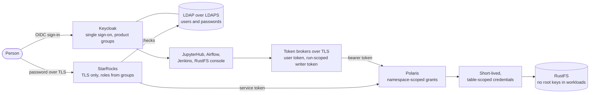

# Security

For everyone, and especially platform admins and product owners: how the platform is secured, layer by layer, and where its limits are. Back to the [README](../README.md).

The platform is built to be **secure by default**: one identity per person, least-privilege access on every system, no long-lived storage keys in workloads, credentials kept out of code and logs, and every check failing closed. It runs on one machine for local development; [the limits](#limits) say what that means.

Text alternative: a person signs in once through Keycloak (users and passwords in LDAP, reached over LDAPS) to every web application, and with the same password over TLS to StarRocks. Spark in JupyterHub and Airflow gets tokens from token brokers over TLS: the user's own token, or a run-scoped writer token. Polaris checks every table access against namespace-scoped grants and hands out short-lived, table-scoped storage credentials; no workload holds RustFS root keys.

## 1. Identity: one person, one account

- **Single sign-on**: JupyterHub, Airflow, Jenkins and the RustFS console sign in through Keycloak (realm `lakehouse`, OIDC); StarRocks checks the same password against LDAP. Users and passwords live in the LDAP directory, reached only over LDAPS, with Argon2 password hashes; groups live in Keycloak.
- **Access by group**: each data product has four groups, `role-<product>-owner`, `-developer`, `-analyst` and `-writer`, plus the platform-wide `role-platform-admin`. Every system derives its permissions from these groups; nothing is granted to individual users.
- **Admission is checked again**: JupyterHub checks the groups at sign-in and again before each server starts; Airflow, JupyterHub and Jenkins read the product files at each sign-in.
- **Service identities**: each product's Airflow runs write as its own writer user (`srv-<product>-writer`), which logs in to StarRocks only with a broker-issued Keycloak token (no password login), for the materialized-view deploy; StarRocks reaches Polaris as `srv-starrocks`; the reconcilers act as the Keycloak administrator ([limits](#limits)).
- **Break-glass accounts** exist only for recovery: Keycloak `admin` (master realm), Jenkins `jenkins-break-glass`, the local Airflow FAB login, StarRocks `root`, and the RustFS root keys. Their secrets are in `.runtime/credentials/`.

Details: [Identity](reference/identity.md).

## 2. Authorization: least privilege on every system

- **One source of truth**: each product's file sets its access levels (`none`, `read`, `write`, `manage`) per role and environment ([access levels](reference/data-products.md#access-levels)), applied identically to Polaris, StarRocks and RustFS.
- **Polaris** (tables): per product role and catalog, privileges only on the product's own namespace; product roles can't create, drop or move namespaces.
- **StarRocks** (SQL): roles named after the groups, with database-scoped grants that mirror Polaris; Polaris is the outer bound (StarRocks reaches it at writer level, so no table drops through it). Catalog metadata (`information_schema`) is filtered by each user's own privileges.
- **RustFS** (console and storage): one policy per group, limited to the product's buckets.
- **Jenkins**: one folder per product, administered by its owners; other products' folders are invisible.
- **Enforcement**: the bootstraps revoke and report any grant that no product file describes, including privileges added by hand; the reconciler keeps Polaris principals and StarRocks users in line with the groups every five minutes.
- **Isolation is tested**: `python3 scripts/verify/role-matrix.py --product <name>` checks every role with temporary identities, including that it can't reach another product.

## 3. Data access: no standing storage keys in workloads

- **Vended credentials**: Spark and StarRocks never hold RustFS root keys. For each table, Polaris issues short-lived credentials scoped to that table (one hour, cached for at most 10 minutes).
- **Checkpoint keys**: streaming checkpoints use one key per product environment bucket, whose only policy allows its `checkpoints/` prefix; an Airflow run gets only its own environment's key, a Jupyter server only the `dev` keys of the user's products, and there is no fallback key ([Streaming checkpoints](reference/streaming-checkpoints.md)).
- **Root keys** are used only server-side by Polaris to issue credentials, and for recovery.

## 4. Workload isolation and token handling

- **Airflow runs**: each DAG run gets its own Spark container with the product's repository mounted read-only. The token broker issues the writer token only if the DAG really comes from the product's own bundle (checked with Airflow), and gives the run a run-scoped renewal capability that is revoked when the run ends; refused runs fail with `unknown_product`, `unknown_dag` or `bundle_mismatch`.
- **No product code in the scheduler**: the scheduler, which holds the Docker socket and the broker control token, parses only the fixed stub; product code runs only inside the run's container. Task arguments are never templated, so a workflow can't read Airflow connections or variables.
- **Jupyter**: each user's server gets that user's own token from the Hub's broker over TLS; the server can't act as anyone else.
- **Tokens stay out of Spark settings and logs**: tokens live in the process environment and never become Spark configuration; Spark redacts secrets, passwords, tokens, keys and credentials in its UI and logs, and the Airflow task output is redacted too.
- **No fallback identity**: a missing or incomplete token source is an error, never a silent fallback to another identity.

## 5. Transport and network

- **TLS where credentials travel**: StarRocks refuses plain-text SQL connections (it receives passwords), LDAP is LDAPS only, and both token brokers serve TLS with their own CA.
- **Loopback only**: every published port binds to `127.0.0.1`; LDAP, the Polaris management port, and the internal service ports are not published.
- **Separate networks**: `core`, `data-access` (Spark to Polaris and RustFS), `jupyter-user` (user servers and the Hub broker), `airflow-internal`, `airflow-spark`, `starrocks`, and `rustfs-identity` (RustFS to Keycloak only) keep each container on the networks it needs.

## 6. Secrets

- **Where they live**: all secrets are generated into `.runtime/credentials/` (directory `0700`, files `0600`), never printed, never written into Compose files or the repository; containers get read-only copies in `.runtime/container-mounts/`.
- **No credentials in product repositories**: product repositories are read anonymously, hold no secrets, and CI refuses the patterns that would smuggle code or packages in (`dags/` beyond the stub, `requirements.txt` with URLs or options).
- **Passwords are never command-line arguments**: the scripts read them from files, the environment, or a prompt without echo.
- **Rotation**: client secrets, LDAP passwords and certificates, the StarRocks catalog secret, and the checkpoint keys each have a documented rotation ([Operations — secrets](reference/operations.md#secrets-and-rotation)).

## 7. Supply chain

- **Pinned images and packages**: container base images are pinned by digest; StarRocks, Keycloak, Polaris, RustFS and Jenkins plugins by version; the workload Python environment by a full lock, installed from wheels only, with each image build failing if it differs from the lock; Maven downloads for the Spark image are checksum-verified.
- **Product extras** are constrained by the platform lock and may never replace a locked version.
- **Monitoring**: Dependabot alerts cover the repository's manifests, and a weekly and on-push workflow scans every external image and the workload lock with Trivy, submitting language packages to the dependency graph (Dependabot) and all findings, operating-system packages included, to Code scanning ([Vulnerability alerts](reference/vulnerability-alerts.md)).

## 8. Verification

| Check | What it proves |
|---|---|
| `scripts/verify/role-matrix.py` | Every role reaches exactly its product's data, and no other product's |
| `scripts/verify/polaris-oidc-negative-cases.py` | Polaris refuses wrong-audience and expired tokens |
| `scripts/verify/keycloak-outage.py` | Behavior while Keycloak is down (issued tokens keep working, new sign-ins fail) |
| `scripts/verify/rustfs-oidc.py`, `jenkins-oidc.py` | Console and Jenkins sign-in follow the groups |
| `scripts/verify/checkpoint-keys.py` | Each checkpoint key reaches only its bucket's `checkpoints/` |
| `./scripts/lakehouse.sh status` | The scheduled reconciler is healthy |

## Limits

This is a single-machine development platform. What that means for security:
- **Local only**: browser sign-ins use plain HTTP and the default password `ChangeM3!` is published; never expose the stack beyond your machine.
- **Reconciler identity**: the reconcilers use the Keycloak `admin` account; use a narrower identity before any shared deployment.
- **Airflow roles are platform-wide**: a product's Airflow roles apply to all of Airflow.
- **Shared keys**: checkpoint keys belong to a product environment, not a person; code in a Jupyter server can read its dev keys.
- **Visible names**: every product's namespace names (not tables or data) are visible to anyone with access to a shared catalog.
- **Public repositories**: product repositories must be readable without credentials.

All limitations: [Known limitations](reference/limitations.md).

## Risk on a cloud provider

An assessment of running the stack on a cloud provider with its published ports reachable from the internet. It is a judgment from how each service is exposed and from the vulnerability scan of 2026-11-13 ([Vulnerability alerts](reference/vulnerability-alerts.md)), not a penetration test.

**Assumptions**:
- Every connection uses HTTPS or TLS, with certificates from a trusted certificate provider (no self-signed certificates, no plain HTTP sign-ins).
- Every user and service account has its own strong password; the published default password is not used.
- The stack is otherwise as built here: one machine, the same ports published (Keycloak, Airflow, JupyterHub, Jenkins, Polaris, RustFS, StarRocks), the same images.

**Overall risk: medium.** Strong passwords and TLS remove the easiest attacks (guessed passwords, credentials read on the network). What remains comes from about ten public services, admin interfaces included, single-factor logins, and the known vulnerabilities of the images that become internet-facing. The Spark and Jupyter jar findings stay low: those containers are not reachable from outside.

| Vulnerability | Risk | Mitigation plan |
|---|---|---|
| Jenkins public: a frequent internet target with a history of exploited core and plugin flaws; plugins are outside the scan | High | Keep Jenkins private (VPN or IP allowlist); stay on the current LTS and update plugins as Jenkins warns |
| Admin interfaces public: the Keycloak admin console, StarRocks FE HTTP (8030), the RustFS console, the Polaris API | Medium-high | Publish only the user-facing apps (Airflow, JupyterHub, Keycloak sign-in, StarRocks SQL); reach the admin interfaces through a VPN, an IP allowlist or a reverse proxy that blocks their paths |
| Single-factor logins: passwords alone, open to phishing and password spraying | Medium-high | Require MFA in Keycloak (covers every web app) and enable its brute-force detection; restrict StarRocks SQL (9030), whose LDAP password logins have no lockout, to known networks or a VPN |
| Known vulnerabilities in internet-facing external images: Keycloak (1 fixable critical), Polaris (1 critical, about 60 high), StarRocks FE and BE (about 180 fixable) | Medium-high | Upgrade to releases that fix them and update the digests; Code scanning lists only fixable findings, so each alert is an upgrade to plan; keep the weekly scan |
| One compromised app controls the host: Airflow and JupyterHub use the Docker socket to start containers, so a stolen account or an app flaw reaches every container and secret | Medium | Rootless Docker or a socket proxy that allows only container start and stop; longer term, Kubernetes with per-workload service accounts ([Future work](future-work.md)) |
| Logged-in users run code: Airflow DAGs and Jupyter notebooks run user code by design | Medium | Keep product roles narrow; MFA; review who holds developer and owner roles; isolate the Docker socket as above |
| Reconcilers use the Keycloak `admin` account | Medium | A dedicated Keycloak client with only the realm roles the reconcilers need |
| No detection: no alerts on failed logins, admin changes or unusual activity | Medium | Forward Keycloak events and service logs to a central log store with alerts on login failures and admin events ([Future work](future-work.md)) |
| Data storage reachable: the RustFS S3 API is public | Medium | Keep the S3 API private (Spark, Polaris and StarRocks reach it inside the network); if it must be public, allow only the IP ranges that need it |
| Spark-bundled jars (Netty, Jackson, Avro in `hadoop-client-runtime` and the Iceberg and AWS bundles) and OS packages without a fix | Low | Not reachable from outside; reduce with the jar cleanup and a newer Spark when Iceberg supports it; dismiss in Code scanning with the reason |

With the admin interfaces private and MFA on (the first three rows), the risk drops to roughly low-medium. Checking the open critical and high CVEs against CISA's Known Exploited Vulnerabilities catalog shows which of the image findings attackers actually use, and sets the order of the upgrades.
